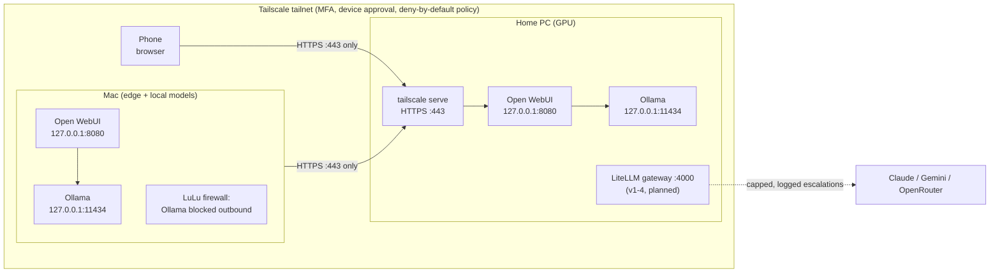

# Architecture and decisions

**What it is:** open-weight AI models running on hardware I own (a Windows PC with a GPU, and a Mac),
reachable privately from my other devices, with security checks at every step. Built step by step with
Claude Code as a pair programmer. Later steps add a gateway with spend caps and two-way handoff between
local models and Claude.

## How it fits together (v1-0)

Only port 443 on the PC is reachable from other devices (4000 is reserved for the gateway).
Ollama, Open WebUI's raw port, SSH, RDP and SMB are blocked, and an edge check script proves it.

## Security layers
| Layer | How | Verified by |
|---|---|---|
| Network | Tailscale, deny-by-default policy, device approval, MFA at the identity provider | `services/tailscale/check-edge.sh` |
| Model servers | Ollama and Open WebUI bound to 127.0.0.1; cloud features off | `check-mac.sh`, `server.log` |
| New models | sha256 check of every file, then first load with **no network**, then a real tool-call test | `modelcheck.py` (pytest-tested) called by `firstload-mac.sh` / after `firstload.ps1` |
| Supply chain | Open WebUI pinned with a hash-locked `uv.lock`; container image pinned; model licenses and watermarking checked before adoption | setup guides |
| Secrets | OS keychain only; gitleaks commit hook that fails closed | `.githooks/pre-commit` |
| Everyday outbound (Mac) | Per-app firewall keeps Ollama offline except during approved downloads | one-line check in `docs/setup/MAC.md` |

## Decisions
| # | Decision | Why | Alternatives considered |
|---|---|---|---|
| 1 | **Tailscale** for remote access | Private network with identity, MFA and policy; nothing exposed to the internet | Port forwarding (exposed), self-hosted VPN (more to run and patch) |
| 2 | Models on **localhost only**; publish just Open WebUI via `tailscale serve` | Smallest attack surface; the gateway becomes the single entry point later | Binding Ollama to the network (no auth) |
| 3 | **Isolated first load** of every new model: Docker `--network none` on the PC, a **macOS sandbox** on the Mac | Catches a runtime or model file that tries to phone home | Docker on Mac (no Apple GPU or MLX: tested), turning Wi-Fi off (too weak: no file isolation) |
| 4 | **Tool use is required and tested**, not assumed from a "tools" badge | Agents and the gateway depend on reliable tool calls | Trusting model-card claims |
| 5 | **Safeguard check** before adopting a model (license, watermarking, hidden prompts) | Avoids surprises later: use restrictions, terms that change, output marking | Ignoring licenses of "open" models |
| 6 | **Per-OS setup paths**; Mac models chosen for the Mac's hardware | Windows+NVIDIA and Apple silicon differ in GPU, model format and isolation tools | One generic guide; keeping both machines on identical models |
| 7 | **Pinned, hash-locked dependencies** | Reproducible installs; a tampered package fails the hash | Floating versions |
| 8 | **Private working repo + sanitized public copy** | Build freely with personal context; share a clean, reusable version | One repo with personal details; inviting people to the private repo |
| 9 | **Machine inbox** (`ops/inbox.json`): one machine leaves checks for another; it runs them on `git pull` and commits the results | Work crosses machines with no inbound access (pull-based, like GitOps tools). Only an allowlist of `modelcheck.py` checks can run, arguments are validated and never pass through a shell (tests try injection); hooks are opt-in because git never runs a repo's hooks unless you set `core.hooksPath` | Self-hosted GitHub Actions runner (an always-on service; unsafe on public repos), SSH from the Mac (inbound access), asking a person to run it |
| 10 | **OpenRouter as the middle tier** (local → big open model → Claude), also used for an eval ceiling row, try-before-download and a second judge | Measures what running locally costs in quality; cheaper escalations than going straight to Claude; evidence before an 18 GB download. Privacy enforced in the gateway: synthetic/redacted data only, no data collection, zero retention, provider pinned for evals | Straight local → Claude (no middle price point), downloading every candidate to test it, a direct key per open-model vendor |
| 11 | **One retrieval store behind MCP** (the "Open Brain" pattern), self-hosted: SQLite + local embeddings on the home PC, `search_kb` on the MCP server | Every tier (local, OpenRouter, Claude) answers from the same knowledge, so the business case compares models, not data. Local keeps it private; our own code keeps the public copy MIT. Read-only and synthetic in v1; agent-written personal memory is Later | Hosted Postgres/pgvector (data leaves the house), a separate store per tool, reusing a source-available memory repo |
| 12 | **Our own router, not a commercial auto-router** (Abacus.AI RouteLLM considered) | Routing rules we can explain, test and tune from eval data; privacy settings we control in the gateway. RouteLLM may appear only as an optional comparison column in the v1-4 business case | Adopting RouteLLM or a multi-model subscription as the router (black-box choices, credit pricing, overlaps LiteLLM + OpenRouter + Claude Code) |

## Measured results (example hardware)
| Machine | Model | Output speed | Notes |
|---|---|---|---|
| PC, RTX 4080 SUPER 16 GB | `gemma4:12b` | 147–160 tok/s | 100% GPU |
| PC, RTX 4080 SUPER 16 GB | `gpt-oss:20b` | 136 tok/s | 100% GPU, 12 GB at 8K context |
| Mac, M5 Pro 48 GB | `north-mini-code-1.0:mlx-nvfp4` | ~85 tok/s | Coding; MLX |
| Mac, M5 Pro 48 GB | `gemma4:26b-mlx` | ~81 tok/s | Everyday; MLX |
| Mac, M5 Pro 48 GB | `qwen3.6:27b-mlx` | ~40 tok/s | Strongest, dense model |

## Roadmap
v1-1 bake-off on both machines + a skill guide per chosen model → v1-2 LiteLLM gateway (one entry
point, keys, budgets, caps; an OpenRouter ceiling run of the eval set) → v1-3 handoff both ways (Claude → local via MCP, local → cloud via the
gateway, three tiers: local → OpenRouter → Claude) plus retrieval over a synthetic policy knowledge base → v1-4 recorded demo, local / open-model / Claude business case, benchmark report, services at boot, backup + restore test.
Each version ships a demo and a tagged release. Details: [`V1-SPEC.md`](V1-SPEC.md).
